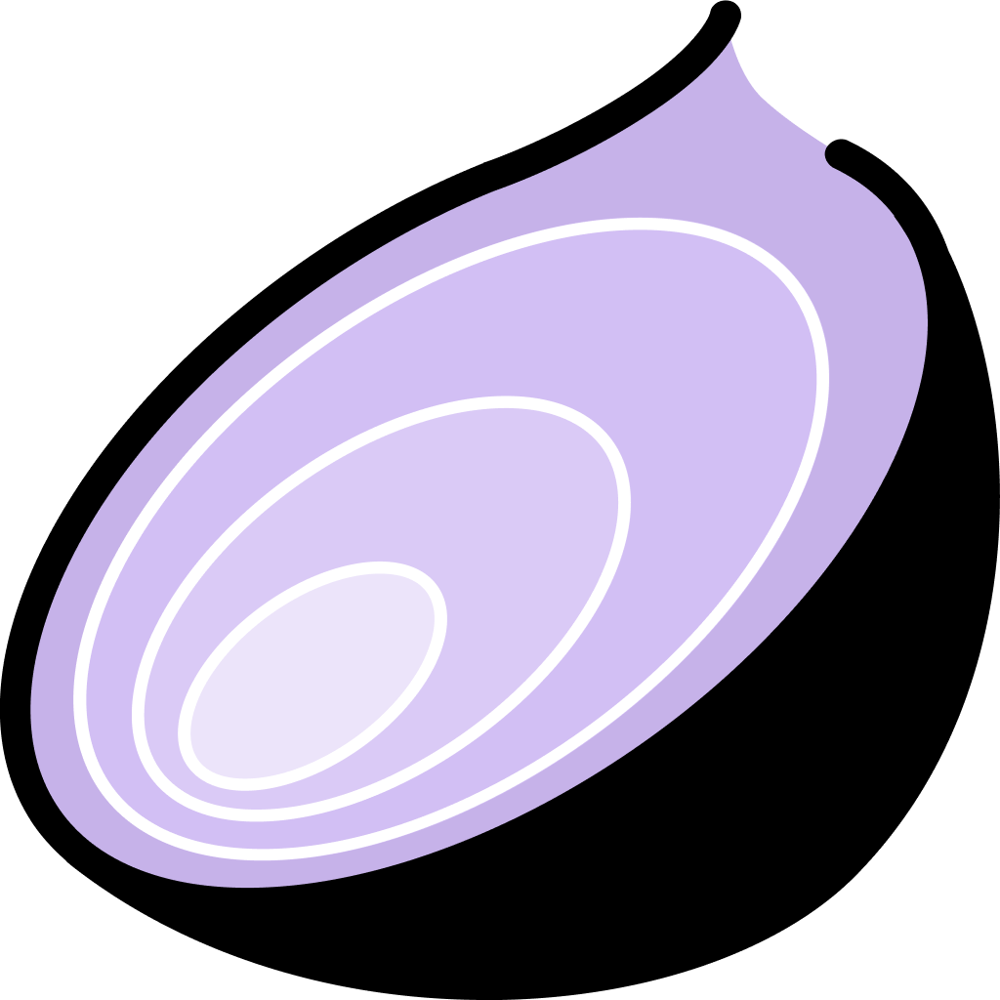
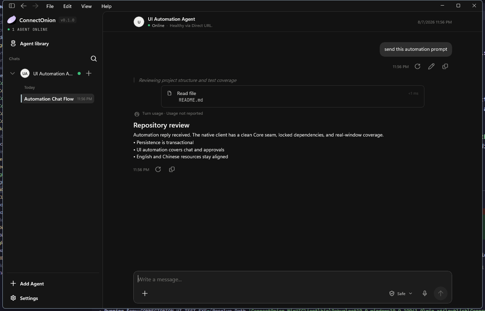
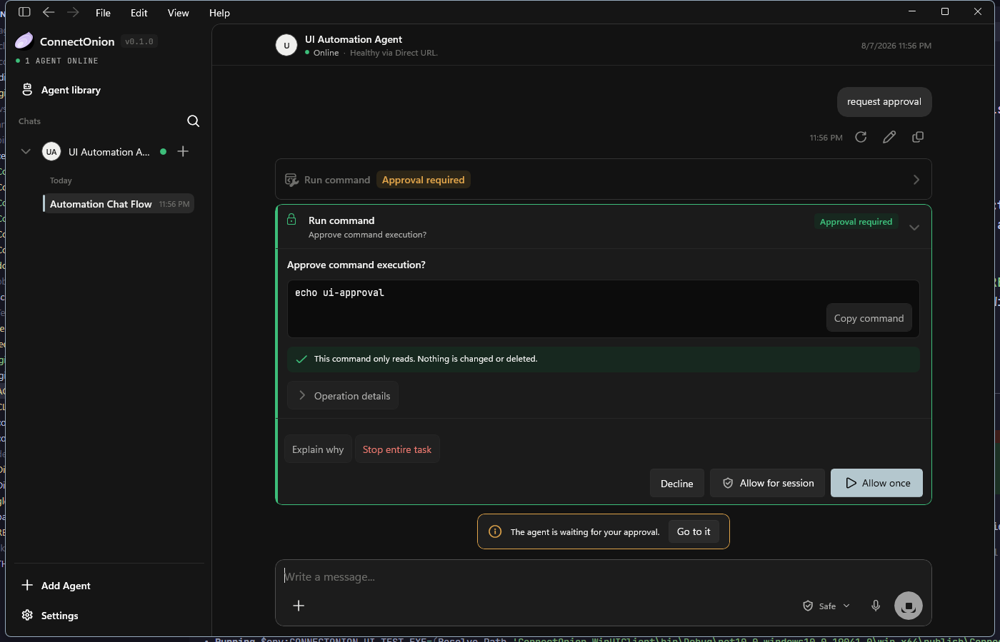
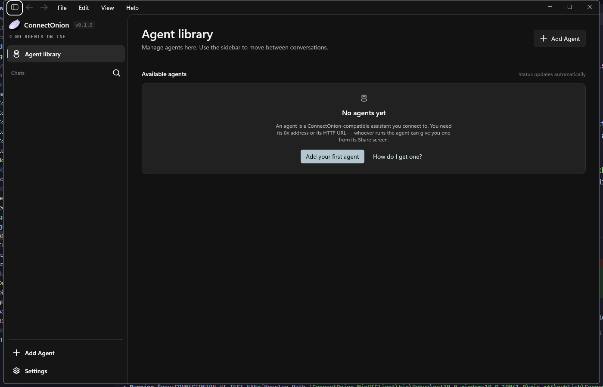
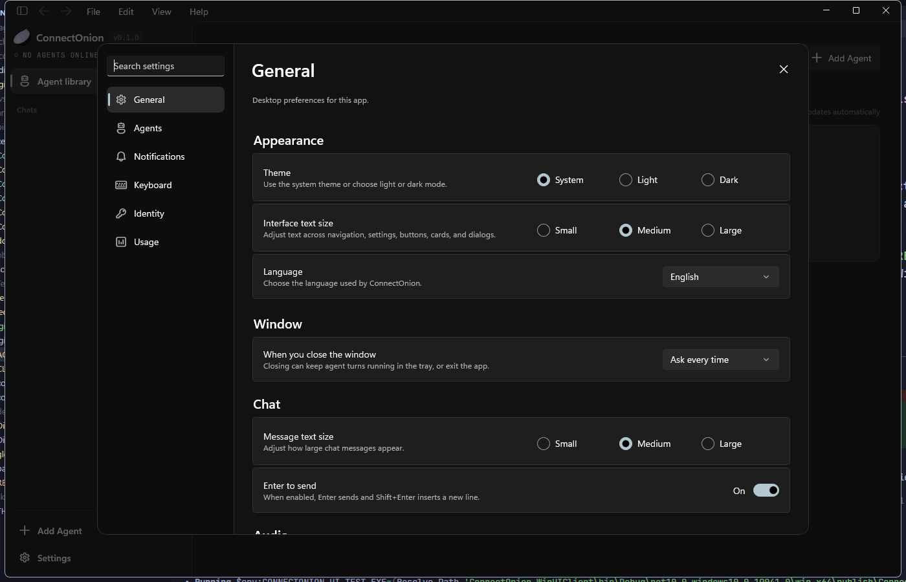

# ConnectOnion Desktop

<p align="center">
  
</p>

<p align="center">
  <a href="../../actions/workflows/ci.yml"></a>
  <a href="../../releases/latest"></a>
  
  
  
</p>

ConnectOnion Desktop is a native Windows app for chatting with ConnectOnion-compatible agents.
It keeps conversations and your ConnectOnion identity on your PC, supports direct and relay
connections, and presents tool activity and approval requests inside the conversation.

## Screenshots

These images are captured from the real WinUI application against an isolated fake agent; they
contain no production account or conversation data.

### Chat and tool activity

<p align="center">
  
</p>

### Approval safety

<p align="center">
  
</p>

<details>
<summary><strong>More: agent library and settings</strong></summary>

<p align="center">
  
</p>

<p align="center">
  
</p>

</details>

**Contents**

- [Screenshots](#screenshots)
- [For users](#for-users)
  - [Download and run](#download-and-run)
  - [First-time setup](#first-time-setup)
  - [What you can do](#what-you-can-do)
  - [Your data and identity](#your-data-and-identity)
  - [Updating or removing the app](#updating-or-removing-the-app)
  - [Troubleshooting](#troubleshooting)
- [For developers](#for-developers)
  - [Prerequisites](#prerequisites)
  - [Build and run](#build-and-run)
  - [Repository layout](#repository-layout)
  - [Architecture at a glance](#architecture-at-a-glance)
  - [Testing](#testing)
  - [Conventions](#conventions)
  - [Continuous integration](#continuous-integration)
  - [Releasing](#releasing)
  - [Documentation map](#documentation-map)
  - [Contributing](#contributing)
- [Project status](#project-status)
- [License](#license)

---

# For users

## Download and run

ConnectOnion Desktop currently ships as an **x64 portable ZIP** for Windows 10 version 1809 or
newer. It includes the required .NET and Windows App SDK runtimes, so you do not need to install
them separately.

1. Open the [latest release](../../releases/latest).
2. Download `ConnectOnion.Desktop-v<version>-x64-portable.zip` and `SHA256SUMS.txt`.
3. Extract the entire ZIP to a folder. Do not run the app from inside the archive.
4. Run `ConnectOnion.WinUIClient.exe`.

The current portable release is not an MSIX installer. Windows may show a reputation warning for
a newly downloaded build; continue only when the file came from this repository's Releases page
and its checksum matches `SHA256SUMS.txt`.

To verify the download in PowerShell:

```powershell
Get-FileHash .\ConnectOnion.Desktop-v<version>-x64-portable.zip -Algorithm SHA256
```

## First-time setup

### 1. Save your recovery phrase

On first launch, the app creates a local ConnectOnion identity and shows its 12-word recovery
phrase. Write the words down in order and keep them offline.

Anyone with the phrase controls the identity. Never share it or paste it into a conversation.
You can reveal it again later under **Settings → Identity → Show recovery phrase**.

### 2. Add an agent

Select **Add Agent** from the Home page or sidebar, then paste the connection supplied by the
agent operator:

| Field | What to enter |
|---|---|
| Agent connection | The agent's `0x…` ConnectOnion address or its HTTPS/HTTP URL |

The app obtains the agent name from the connection automatically; you can rename it locally after
adding it. Use **Test connection** to check the endpoint, then select **Add agent**. If the agent
requires onboarding, the app asks for the invite code during that flow. Choose the agent from the
sidebar, start a conversation, and send a message.

## What you can do

- Chat with multiple agents and keep separate conversation histories.
- Connect through a direct URL or ConnectOnion relay lookup.
- Send images and files when the selected agent supports them.
- Review tool activity, approval requests, plans, and interactive questions inline.
- Search conversation titles and transcript content.
- Use speech-to-text dictation for message input.
- Switch between English and Simplified Chinese, light and dark themes, and three text sizes.
- Customize keyboard shortcuts and keep the app available from the system tray.
- Review per-model token usage and activity history in Settings.

### Approving what an agent wants to do

When an agent asks to run something, the request appears as its own card at the end of the
conversation, with the exact command, the arguments behind **Operation details**, and a risk line
derived from the command itself rather than a fixed warning shown on every request. A read-only
command says so; an unrecognised one says it was not recognised and asks you to read it. For a
destructive command the emphasis moves off **Allow once** deliberately, and **Stop entire task**
asks for confirmation because it ends the whole turn rather than just that step.

While a decision is waiting, the composer's send button is disabled and a bar above it explains
why — the card is the only place an answer counts. **Ctrl+Shift+D** jumps to it.

## Your data and identity

The portable app stores its data under:

```text
%APPDATA%\ConnectOnion\
```

This folder contains the SQLite conversation database, agent icons, received-image cache, and
diagnostic logs. Removing or replacing the extracted application folder does not remove this
data.

The private identity is encrypted for your current Windows account. Copying the database to
another computer is **not** an identity backup because the other Windows account cannot decrypt
it. Restore the identity on another device with the recovery phrase from **Settings → Identity**.

## Updating or removing the app

To update:

1. Close ConnectOnion Desktop from **File → Exit** or the tray menu.
2. Download and extract the new release to a new folder.
3. Run the new `ConnectOnion.WinUIClient.exe`.

Your existing data under `%APPDATA%\ConnectOnion` is upgraded in place when necessary.

To remove the portable app, delete its extracted folder. If you also want to erase conversations,
agent settings, logs, and the local identity, delete `%APPDATA%\ConnectOnion` separately—but first
save the recovery phrase for any identity you may want to restore.

## Troubleshooting

### The app does not start

- Confirm that Windows is 64-bit Windows 10 version 1809 or newer.
- Extract every file from the ZIP and keep the files together.
- Check whether Windows Security or another security product quarantined a file.
- Review the newest log under `%APPDATA%\ConnectOnion\logs`.

### An agent does not connect

- Open the agent details and run **Test connection** again.
- Confirm the `0x…` address or HTTP(S) connection URL with the agent operator.
- If onboarding asks for an invite code, confirm that code separately with the operator.
- For an HTTP(S) connection, verify that the host is reachable from your network.
- A grey or amber status can mean the agent is offline or temporarily unavailable.

### Windows notifications are unavailable

In-app alerts continue to work while the window is open. Background Windows notifications depend
on the Windows notification service available on the PC and may be unavailable for a portable
deployment.

### My identity changed after moving data

Identity encryption is tied to the Windows account that created it. Use **Settings → Identity →
Restore** and enter the original recovery phrase instead of copying `connectonion.db`.

For problems that remain, open an [issue](../../issues) and attach the app version, Windows
version, reproduction steps, and relevant log lines. Remove addresses, invite codes, API keys,
recovery phrases, private keys, and conversation content before sharing a log.

---

# For developers

This section is the on-ramp. The authoritative architecture description is
[`CLAUDE.md`](./CLAUDE.md) at the repository root — **where anything here disagrees with it,
`CLAUDE.md` is right**. Deeper engineering documents live in [`docs/`](./docs/README.md).

## Prerequisites

| Requirement | Version | Notes |
|---|---|---|
| Windows | 10 version 1809 (build 17763) or newer, x64 | `TargetPlatformMinVersion` is 10.0.17763.0 |
| .NET SDK | 10.0.3xx | Pinned by [`global.json`](./global.json) (`rollForward: latestPatch`) |
| Windows App SDK | 1.x (restored via NuGet) | No separate install needed |
| Node.js | 22 | Only for the protocol conformance gate's reference signer (`ref-sign.js`) |
| Visual Studio 2022 | 17.x with **.NET Desktop** and **Windows App SDK C# Templates** | Optional, but the most reliable path for XAML debugging |

`Platform` must be `x64`, `x86`, or `ARM64`. `Any CPU` does not work for the WinUI project.

## Build and run

```powershell
git clone <this repository>
cd <clone directory>

# Restore and build everything (app, core, protocol, conformance, all four test projects)
dotnet restore ConnectOnion.WinUIClient\ConnectOnion.WinUIClient.sln -p:Platform=x64
dotnet build   ConnectOnion.WinUIClient\ConnectOnion.WinUIClient.sln -c Debug --no-restore -p:Platform=x64

# Run unpackaged — the fast CLI loop, no MSIX deploy step
dotnet run --project ConnectOnion.WinUIClient\ConnectOnion.WinUIClient.csproj -p:Platform=x64 -p:RunUnpackaged=true
```

> The solution file lives at `ConnectOnion.WinUIClient/ConnectOnion.WinUIClient.sln` even though it
> references every other project by relative path.

For XAML debugging, open that solution in Visual Studio and F5 with **Debug/x64** and *Deploy*
checked for `ConnectOnion.WinUIClient` in Configuration Manager.

To point the app at an isolated data directory (useful when you do not want to touch your real
conversations):

```powershell
$env:CONNECTONION_DATA_ROOT = "$env:TEMP\ConnectOnionDev"
```

## Repository layout

| Project | In `.sln` | In CI | Purpose |
|---|---|---|---|
| `ConnectOnion.WinUIClient/` | yes | build | The WinUI 3 app: XAML, code-behind, and anything needing a window or the Windows App SDK |
| `ConnectOnion.WinUIClient.Core/` | yes | via tests | **Every WinUI-free surface of the client**: models, SQLite repositories, notification policy, projections, view models |
| `ConnectOnion.Protocol/` | yes | build | Transport-agnostic protocol library (`net10.0`, no WinUI dependency) |
| `ConnectOnion.PortableLauncher/` | yes | build + release | Dependency-free NativeAOT launcher placed at the portable ZIP root |
| `ConnectOnion.Protocol.Conformance/` | yes | yes | Cross-checks C# Ed25519 / canonical-JSON signing against a Node.js reference signer |
| `ConnectOnion.Protocol.LiveTest/` | no | manual only | Console smoke test against a real deployed agent |
| `tests/ConnectOnion.Protocol.Tests/` | yes | yes | Wire schema, encoding, event parsing |
| `tests/ConnectOnion.WinUIClient.UnitTests/` | yes | yes | Headless tests over `Core`, plus the ArchUnitNET layer gate and source contract tests |
| `tests/ConnectOnion.IntegrationTests/` | yes | yes | Real SQLite file: schema, migrations, repositories, identity store |
| `tests/ConnectOnion.WinUIClient.UITests/` | yes | yes | FlaUI (UIA3) real-window smoke tests |
| `tests/ConnectOnion.TrimSmoke/` | no | opt-in | Trimmed console harness proving serialization and persistence survive trimming |

## Architecture at a glance

**`ConnectOnion.WinUIClient.Core` is the seam that makes the client testable, and getting a file on
the right side of it is the whole game.** The app project cannot be referenced by a test project —
it drags in the Windows App SDK, which a headless test host cannot load — so anything that needs
coverage lives in `Core`, which the test projects reference normally. Moving a production file into
`Core` is how you bring it under test. If a file will not move because it pulls in XAML types, that
is a signal its logic wants splitting into a WinUI-free class.

The boundary is enforced, not merely described:
`tests/ConnectOnion.WinUIClient.UnitTests/Architecture/LayerDependencyTests.cs` fails the build if
`Core` takes a `Microsoft.UI` dependency.

```
┌─────────────────────────────────────────────────────────────┐
│ ConnectOnion.WinUIClient        XAML, pages, controls,      │
│                                 window/DPI/tray/pickers     │
└───────────────┬─────────────────────────────────────────────┘
                │ ProjectReference          ▲ InternalsVisibleTo
┌───────────────▼─────────────────────────────────────────────┐
│ ConnectOnion.WinUIClient.Core   models · SQLite repos ·      │
│                                 run runtime · projections ·  │
│                                 view models · notifications  │
└───────────────┬─────────────────────────────────────────────┘
                │
┌───────────────▼─────────────────────────────────────────────┐
│ ConnectOnion.Protocol           WebSocket state machine ·    │
│                                 wire frames · Ed25519 · BIP39│
└─────────────────────────────────────────────────────────────┘
```

A few load-bearing decisions worth knowing before you change things:

- **Connections and turns are owned app-level, not by pages.** `AgentSessionManager` holds the
  per-conversation WebSockets and drives each turn. A `ChatPage` only subscribes; closing it does
  not cancel the turn, and a turn completes (and notifies) with no page open at all.
- **One projection maps stream events to bubbles.** `ChatTurnProjection` drives the live view and
  the headless persist path identically. New event handling goes there, never in one of the two
  callers.
- **Schema changes go through `Data/SchemaMigrator.cs`.** Append a migration and bump
  `LatestVersion`; never edit or renumber a released one. The version lives in SQLite's own
  `PRAGMA user_version`.
- **Two sanctioned JSON mechanisms exist and there is no third**: source-generated contexts for
  blobs we define, and `WireJson` / a hand-written `Utf8JsonWriter` for shapes the host defines.
  Release builds are trimmed, so the reflection serializer *throws* rather than merely risking a
  trimmed member.

## Testing

```powershell
# Headless suites — the everyday loop
dotnet test tests\ConnectOnion.Protocol.Tests\ConnectOnion.Protocol.Tests.csproj
dotnet test tests\ConnectOnion.WinUIClient.UnitTests\ConnectOnion.WinUIClient.UnitTests.csproj
dotnet test tests\ConnectOnion.IntegrationTests\ConnectOnion.IntegrationTests.csproj

# Protocol conformance gate (matches CI exactly; needs Node.js)
dotnet run --project ConnectOnion.Protocol.Conformance\ConnectOnion.Protocol.Conformance.csproj -c Release

# Coverage ratchet, as CI computes it
powershell -NoProfile -ExecutionPolicy Bypass -File scripts\Test-Coverage.ps1 -ResultsDirectory TestResults
```

Current snapshot: **1,143** headless client unit tests, **197** integration tests, **225** protocol
tests, and a FlaUI suite that reports **31 passed / 1 skipped** on every push. One passing entry is
the opt-in memory probe's intentional no-op, leaving 30 required real-window assertions.

The real-window suite needs a **published** executable — the plain `bin\` build carries no
unpackaged Windows App SDK bootstrapper, so every test silently skips against it:

```powershell
dotnet publish ConnectOnion.WinUIClient\ConnectOnion.WinUIClient.csproj `
  -c Debug --runtime win-x64 --no-restore -p:Platform=x64 `
  -p:RunUnpackaged=true -p:SelfContained=true -p:WindowsAppSDKSelfContained=true `
  -p:AppxPackageSigningEnabled=false

$env:CONNECTONION_UI_TEST_EXE = (Resolve-Path 'ConnectOnion.WinUIClient\bin\Debug\net10.0-windows10.0.19041.0\win-x64\publish\ConnectOnion.WinUIClient.exe')
$env:CONNECTONION_DATA_ROOT   = Join-Path $env:TEMP "ConnectOnionUiSmoke-$([guid]::NewGuid())"
dotnet test tests\ConnectOnion.WinUIClient.UITests\ConnectOnion.WinUIClient.UITests.csproj
```

**Coverage is a ratchet, not a fixed threshold.** [`coverage-baseline.json`](./coverage-baseline.json)
holds the high-water mark per assembly, and a run fails when coverage drops below it by more than
0.25pp. Coverage that rises passes and prints the new figure; advancing the baseline is a
deliberate `-UpdateBaseline` commit, never something CI does.

The gate also prints what it *cannot* measure: `ConnectOnion.WinUIClient` appears in no coverage
figure and cannot, because a headless host cannot load the Windows App SDK and the FlaUI suite runs
out-of-process. That blind spot is stated explicitly rather than left to look like 0%.

See [`docs/TEST_PLAN.md`](./docs/TEST_PLAN.md) for the layered strategy and the owned backlog.

## Conventions

- **Commits** follow [Conventional Commits](./docs/GIT_COMMIT_CONVENTION.md):
  `<type>(<scope>): <summary>`. PR titles use the same format.
- **MVVM** is CommunityToolkit.Mvvm source generators on `partial` properties, not backing fields.
  Dependency injection is the .NET Generic Host; view models take constructor parameters and are
  registered transient.
- **Large types split into partial files** named `Type.Aspect.cs`. That is this repo's standard
  answer to a file growing past ~500 lines — not a new class, and not regions.
- **Localization** covers `en-US` and `zh-CN`, which must stay key-for-key identical. Views use
  `x:Uid` and **keep their fallback text in the XAML**. Code in `Core` goes through
  `Common/CoreStrings`. `Architecture/LocalizationResourceTests` and `CoreLocalizationTests` are
  the gates.
- **Logging** is Serilog behind `ILogger<T>`, with every call site a pre-compiled
  `LoggerMessage.Define` delegate (CA1848 is on). `Debug.WriteLine` is never a failure path's only
  record — it compiles away in Release.
- **Automation IDs** are a source-level contract: every interactive element with an `x:Name` must
  also expose `AutomationProperties.AutomationId`, enforced by `AutomationContractTests`.
- There is **no lint or format command** configured beyond CI's `dotnet format --verify-no-changes`
  whitespace check.

## Continuous integration

[`.github/workflows/ci.yml`](./.github/workflows/ci.yml) runs on `windows-latest` for every push
and pull request:

1. Restore, verify C# whitespace formatting, audit NuGet for known vulnerabilities.
2. Build the solution in Release/x64 with packaging disabled.
3. Run the three headless suites with Cobertura coverage collection, then the ratchet gate.
4. Publish a self-contained ReadyToRun unpackaged build and run the FlaUI shell/chat suite against
   it, uploading TRX and screenshots **unconditionally** — a failing PR is exactly when those
   matter.
5. Run the trimmed serialization harness and the full trimming audit.
6. End on the protocol conformance gate.

`ConnectOnion.Protocol.LiveTest` runs only through an explicit manual workflow dispatch, because it
depends on a deployed agent.

## Releasing

Pushing a `v*` tag triggers [`.github/workflows/release.yml`](./.github/workflows/release.yml),
which repeats the full CI suite rather than trusting the commit's earlier run, then builds and
audits the self-contained portable archive and attaches it — with `SHA256SUMS.txt` — to a GitHub
Release. A prerelease tag publishes as a GitHub prerelease.

The publish step is deliberately last: a failure anywhere leaves the tag pushed and no release
published, which is recoverable (delete the tag, fix, re-tag) in a way that a half-published
release is not.

**Trimming is on for Release builds.** [`docs/TRIMMING.md`](./docs/TRIMMING.md) is the gate that
decided it — read it before changing `PublishTrimmed` in either direction, and note that
`TrimmingGateTests` fails the build if the setting changes.

Full procedure, size budgets and the validation matrix: [`docs/RELEASE.md`](./docs/RELEASE.md).

## Documentation map

| Document | What it is |
|---|---|
| [`CLAUDE.md`](./CLAUDE.md) / [`AGENTS.md`](./AGENTS.md) | **Authoritative architecture.** Same content, two tool-specific openings — edit both or neither |
| [`docs/README.md`](./docs/README.md) | Index of everything below, with a status column |
| [`docs/DEVELOPMENT.md`](./docs/DEVELOPMENT.md) | Developer guide: setup, commands, agent endpoints, implementation status |
| [`docs/SESSION_MESSAGE_STRUCTURE.md`](./docs/SESSION_MESSAGE_STRUCTURE.md) | The ConnectOnion wire protocol |
| [`docs/TEST_PLAN.md`](./docs/TEST_PLAN.md) | Test strategy, coverage ratchet, E2E flows, backlog |
| [`docs/PROJECT_BRIEF.md`](./docs/PROJECT_BRIEF.md) | Original requirements plus a traceability table |
| [`docs/CONCURRENCY.md`](./docs/CONCURRENCY.md) | Where threads come from and which primitive guards what |
| [`docs/PERFORMANCE.md`](./docs/PERFORMANCE.md) · [`docs/TRIMMING.md`](./docs/TRIMMING.md) | Benchmarks, budgets, and the trimming gate |
| [`docs/RELEASE.md`](./docs/RELEASE.md) | Versioning, payload gates, checksums, validation matrix |

## Contributing

1. Branch from `main`.
2. Keep the change on the right side of the `Core` seam — if it needs a test, it belongs in `Core`.
3. Add or update tests. A behaviour change that no test notices is a behaviour change nobody will
   notice breaking later.
4. Run the three headless suites and the conformance gate locally before opening a PR.
5. Use a Conventional Commits title.

If a change contradicts something in `CLAUDE.md`, update `CLAUDE.md` **and** `AGENTS.md` in the same
PR. Two architecture documents that disagree is worse than one that is slightly out of date.

---

## Project status

Working and covered by tests: multi-agent chat over direct and relay connections, streaming turns
with tool timelines, interactive cards (approvals, questions, plan review, diff previews),
attachments, transcript search, dictation, notifications and tray, usage accounting, identity with
BIP39 backup and restore, localization, theming, and the portable release pipeline.

Known gaps, tracked rather than hidden:

- **No signed MSIX.** The release pipeline builds a portable ZIP only; the MSIX build/signing path
  is dormant and nothing has been signed or installed. See [`docs/RELEASE.md`](./docs/RELEASE.md).
- **UI-level coverage is selective.** The required FlaUI suite drives the main shell and chat
  flows; OS notification delivery and click-through remain a manual boundary, and the
  Explorer-based drag-and-drop diagnostic is deliberately skipped because its source coordinates
  vary with desktop DPI.
- **x64 only.** No ARM64 or x86 release artifact is produced today.

## License

No license has been declared for this repository yet. Until a `LICENSE` file is added, all rights
are reserved by the authors and the terms of use are whatever the course or client agreement
specifies.

## Related projects

ConnectOnion protocol implementations:

- [Python](https://github.com/openonion/connectonion)
- [TypeScript](https://github.com/openonion/connectonion-ts)
