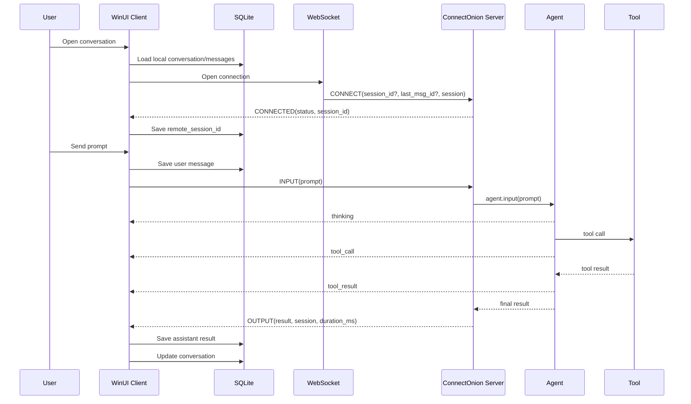
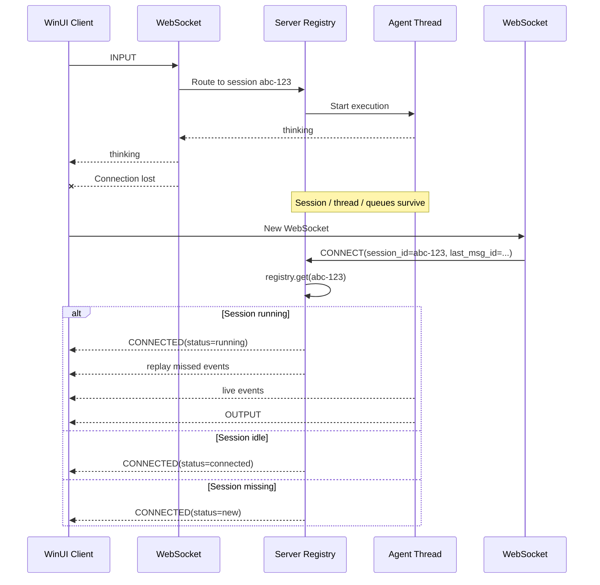

# ConnectOnion 对话交互与 Session 消息结构总结

> 基于当前 ConnectOnion 官方 WebSocket Protocol / Session Reconnect 文档，以及本次对话中提供的实际 `sessions` JSON 返回数据整理。  
> 适用于你当前的 WinUI 3 + C# + SQLite 桌面客户端设计。

---

## 1. 核心结论

ConnectOnion 的一次完整对话交互需要区分四个概念：

| 概念 | 含义 | 生命周期 |
|---|---|---|
| WebSocket Connection | 一条具体网络连接 | WebSocket 关闭即结束 |
| Session | 逻辑会话与远程执行上下文 | 可跨多次 INPUT/OUTPUT，也可跨 WebSocket 重连 |
| Execution | 一次 `INPUT -> OUTPUT` 执行 | 收到最终 OUTPUT 后结束 |
| Conversation | 用户长期聊天历史 | 主要由客户端持久化，可长期存在 |

最重要的关系：

```text
Conversation
    │
    └── Session
          │
          ├── Execution 1
          │     INPUT
          │       ↓
          │     events
          │       ↓
          │     OUTPUT
          │
          ├── Execution 2
          │     INPUT
          │       ↓
          │     events
          │       ↓
          │     OUTPUT
          │
          └── Execution 3
                ...
```

同时，一个 Session 可以经历多个 WebSocket 连接：

```text
Session abc-123
    │
    ├── WebSocket #1
    │      ↓ disconnect
    ├── WebSocket #2
    │      ↓ disconnect
    └── WebSocket #3
```

因此：

```text
一条消息 = 一个 Session                ❌
一次 WebSocket = 永久等于一个 Session   ❌
一次 INPUT -> OUTPUT = 一个 Execution   ✅
多个 Execution 可以属于同一个 Session   ✅
同一个 Session 可以跨 WebSocket 重连     ✅
```

---

## 2. 总体交互流程

正常新会话：

```text
Client                                      Agent Server
  │                                             │
  │── WebSocket Open ──────────────────────────►│
  │                                             │
  │── CONNECT ─────────────────────────────────►│
  │   auth + optional session_id + session      │
  │                                             │
  │◄─ CONNECTED ────────────────────────────────│
  │   session_id + status                       │
  │                                             │
  │◄─ PING ─────────────────────────────────────│
  │── PONG ────────────────────────────────────►│
  │                                             │
  │── INPUT ───────────────────────────────────►│
  │   prompt / images / files                   │
  │                                             │
  │◄─ thinking ─────────────────────────────────│
  │◄─ tool_call ────────────────────────────────│
  │◄─ tool_result ──────────────────────────────│
  │◄─ OUTPUT ───────────────────────────────────│
  │   result + session                          │
  │                                             │
  │── INPUT ───────────────────────────────────►│
  │   next prompt                               │
  │                                             │
  │◄─ ... ──────────────────────────────────────│
  │◄─ OUTPUT ───────────────────────────────────│
```

同一个 WebSocket 在 `CONNECTED` 后可以发送多次 `INPUT`。

---

## 3. Session ID 是谁生成的

### 3.1 新 Session

第一次创建新 Session 时，客户端可以不发送 `session_id`：

```json
{
  "type": "CONNECT",
  "session": {
    "messages": []
  },
  "payload": {
    "to": "0xAgentAddress",
    "timestamp": 1702234567
  },
  "from": "0xClientPublicKey",
  "signature": "0x..."
}
```

服务端返回：

```json
{
  "type": "CONNECTED",
  "session_id": "550e8400-...",
  "status": "new"
}
```

因此通常是：

```text
Client 不提供 session_id
        ↓
Server 创建新 Session
        ↓
Server 分配 session_id
        ↓
Client 保存 session_id
```

### 3.2 恢复已有 Session

客户端重连时发送已有 `session_id`：

```json
{
  "type": "CONNECT",
  "session_id": "550e8400-...",
  "last_msg_id": "ev-9f12...",
  "session": {
    "messages": []
  },
  "payload": {
    "to": "0xAgentAddress",
    "timestamp": 1702234567
  },
  "from": "0xClientPublicKey",
  "signature": "0x..."
}
```

服务端根据 registry 中的状态决定：

```text
session_id 存在 + running
    → status = "running"

session_id 存在 + idle
    → status = "connected"

session_id 不存在
    → status = "new"
```

当前官方协议还说明：如果客户端提供了一个不在 registry 中的 `session_id`，服务端会按 fresh session 处理，并可沿用该 ID。

---

## 4. CONNECT 消息

`CONNECT` 是每条 WebSocket 连接上的第一条协议消息。

### 4.1 结构

```json
{
  "type": "CONNECT",
  "session_id": "550e8400-...",
  "last_msg_id": "ev-9f12...",
  "session": {
    "messages": [],
    "mode": "safe"
  },
  "payload": {
    "to": "0x3d4017c3e843...",
    "timestamp": 1702234567
  },
  "from": "0xClientPublicKey",
  "signature": "0x..."
}
```

### 4.2 字段说明

| 字段 | 是否必须 | 含义 |
|---|---|---|
| `type` | 是 | 固定为 `CONNECT` |
| `session_id` | 否 | 恢复已有 Session；新 Session 可省略 |
| `last_msg_id` | 否 | 客户端最后完整处理的流事件 ID，用于断线重放 |
| `session` | 否 | 客户端当前会话状态，例如 messages |
| `payload` | 是 | 被签名的认证 payload |
| `from` | 是 | 客户端公钥地址 |
| `signature` | 是 | Ed25519 签名 |

### 4.3 作用

CONNECT 同时完成：

```text
认证
+
Session 创建或恢复
+
客户端 Conversation History 同步到服务端
+
必要时服务端返回更新后的 Session
```

---

## 5. CONNECTED 消息

服务端对 CONNECT 的响应：

```json
{
  "type": "CONNECTED",
  "session_id": "550e8400-...",
  "status": "new",
  "server_newer": true,
  "session": {
    "messages": []
  },
  "chat_items": []
}
```

### 5.1 status

| status | 含义 | 客户端行为 |
|---|---|---|
| `new` | 新 Session 或旧 Session 已找不到 | 可以发送 INPUT |
| `connected` | Session 存活，当前空闲 | 可以发送 INPUT |
| `running` | Agent 仍在执行 | 等待 replay / streaming events |

### 5.2 server_newer

如果服务端 Session 比客户端新：

```json
{
  "server_newer": true,
  "session": {
    "messages": []
  },
  "chat_items": []
}
```

客户端应更新本地 UI / 状态。

---

## 6. INPUT 消息

在收到 CONNECTED 后发送。

### 6.1 普通文本

```json
{
  "type": "INPUT",
  "prompt": "check my latest unread email"
}
```

### 6.2 带图片

```json
{
  "type": "INPUT",
  "prompt": "分析这张图片",
  "images": [
    "data:image/png;base64,..."
  ]
}
```

### 6.3 带文件

```json
{
  "type": "INPUT",
  "prompt": "总结这个 PDF",
  "files": [
    {
      "name": "report.pdf",
      "data": "data:application/pdf;base64,..."
    }
  ]
}
```

### 6.4 字段

| 字段 | 是否必须 | 含义 |
|---|---|---|
| `type` | 是 | 固定 `INPUT` |
| `prompt` | 是 | 用户输入 |
| `images` | 否 | base64 data URL 图片 |
| `files` | 否 | 内联 base64 文件对象 |

关键点：

```text
INPUT 不需要再次携带完整 session
```

因为当前 WebSocket 已经通过 CONNECT 绑定到 Session。

---

## 7. 一次 Execution 的消息流

一次普通 Execution：

```text
INPUT
  ↓
user_input
  ↓
thinking
  ↓
llm_call
  ↓
llm_result
  ↓
可能出现 tool_call
  ↓
tool_result
  ↓
可能再次 llm_call
  ↓
llm_result
  ↓
OUTPUT
```

例如：

```text
User: "check my latest unread email"
       ↓
thinking
       ↓
LLM decides to call read_inbox
       ↓
tool_call
       ↓
tool_result: "No emails found."
       ↓
thinking / reflect
       ↓
LLM final response
       ↓
OUTPUT
```

---

## 8. 流式事件结构

Agent 执行过程中，服务端可以在最终 OUTPUT 之前发送事件。

常见类型：

| type | 含义 |
|---|---|
| `thinking` | Agent 中间推理/状态 |
| `tool_call` | 开始调用工具 |
| `tool_result` | 工具执行完成 |
| `ask_user` | 需要用户补充输入 |
| `approval_needed` | 工具操作需要审批 |
| `plan_review` | 计划等待审阅 |
| `compact` | 上下文压缩 |

概念示例：

```json
{
  "type": "thinking",
  "content": "I will check the inbox."
}
```

```json
{
  "type": "tool_call",
  "name": "read_inbox",
  "args": {
    "unread": true,
    "last": 1
  }
}
```

```json
{
  "type": "tool_result",
  "name": "read_inbox",
  "status": "success",
  "result": "No emails found."
}
```

注意：你实际 `trace` 中的事件结构比 WebSocket 简化示例更丰富，通常还带：

```text
id
ts
session_id
iteration
duration_ms
usage
model
status
```

---

## 9. OUTPUT 消息

一次 Execution 完成：

```json
{
  "type": "OUTPUT",
  "result": "It looks like you don't have any unread emails.",
  "session_id": "550e8400-...",
  "duration_ms": 1250,
  "session": {
    "messages": [],
    "trace": [],
    "turn": 2
  }
}
```

关键点：

```text
OUTPUT = 当前 Execution 结束
OUTPUT ≠ Session 死亡
```

完成后 Session 仍可继续：

```text
OUTPUT #1
   ↓
INPUT #2
   ↓
OUTPUT #2
   ↓
INPUT #3
   ↓
OUTPUT #3
```

---

## 10. 你实际返回的 sessions 列表结构

本次对话提供的实际 JSON 顶层为：

```json
{
  "sessions": [
    {
      "session_id": "a985fbf5-...",
      "status": "done",
      "prompt": "ddadada",
      "result": "...",
      "session": {
        "session_id": "a985fbf5-...",
        "messages": [],
        "trace": [],
        "turn": 2,
        "user_prompt": "ddadada",
        "intent": "...",
        "iteration": 1,
        "result": "...",
        "updated": 1783233428.7857492
      },
      "created": 1783233420.4608629,
      "expires": 1783319820.4608629,
      "duration_ms": 8322
    }
  ]
}
```

可以拆成：

```text
sessions[]
  │
  └── Result Record
        ├── session_id
        ├── status
        ├── prompt
        ├── result
        ├── created
        ├── expires
        ├── duration_ms
        │
        └── session
              ├── session_id
              ├── messages[]
              ├── trace[]
              ├── turn
              ├── user_prompt
              ├── intent
              ├── iteration
              ├── result
              └── updated
```

---

## 11. 外层 sessions[] 元素

示例：

```json
{
  "session_id": "a985fbf5-4b70-4b61-b835-c90524c1e9b4",
  "status": "done",
  "prompt": "ddadada",
  "result": "I'm still not sure...",
  "session": {},
  "created": 1783233420.4608629,
  "expires": 1783319820.4608629,
  "duration_ms": 8322
}
```

字段理解：

| 字段 | 含义 |
|---|---|
| `session_id` | Session 唯一 ID |
| `status` | 该结果记录/执行结果状态，例如 `done` |
| `prompt` | 该记录对应的最新 prompt |
| `result` | 最终输出 |
| `session` | 完整 Session 快照 |
| `created` | 记录创建时间 |
| `expires` | 结果过期时间 |
| `duration_ms` | 执行耗时 |

### 11.1 不要混淆两套 status

外层数据：

```json
{
  "status": "done"
}
```

WebSocket CONNECTED：

```json
{
  "status": "new"
}
```

或：

```json
{
  "status": "connected"
}
```

或：

```json
{
  "status": "running"
}
```

这两者不是同一套状态语义。

建议理解：

```text
sessions[] 外层 status
    = Result / execution record 状态

CONNECTED.status
    = 当前远程 Session 状态
```

---

## 12. session.messages 结构

`messages` 是面向 LLM 对话上下文的消息历史。

### 12.1 User Message

```json
{
  "role": "user",
  "content": "hi"
}
```

### 12.2 Assistant Text Message

```json
{
  "role": "assistant",
  "content": "Hi there! How can I help you today?"
}
```

### 12.3 Assistant Tool Call Message

你实际数据中：

```json
{
  "role": "assistant",
  "tool_calls": [
    {
      "id": "call_00_ixRY6qOmP6GPgSPvfbFg4111",
      "type": "function",
      "function": {
        "name": "count_unread",
        "arguments": "{}"
      }
    },
    {
      "id": "call_01_ghogJPc3qRMXvNzIRQT05719",
      "type": "function",
      "function": {
        "name": "read_inbox",
        "arguments": "{\"unread\": true, \"last\": 5}"
      }
    }
  ]
}
```

注意：

```text
function.arguments 是 JSON 字符串
```

不是直接嵌套对象。

例如：

```json
"arguments": "{\"unread\": true, \"last\": 5}"
```

客户端若要显示参数，需要二次反序列化。

### 12.4 Tool Result Message

```json
{
  "role": "tool",
  "content": "You have 0 unread email(s).",
  "tool_call_id": "call_00_ixRY6qOmP6GPgSPvfbFg4111"
}
```

对应关系：

```text
assistant.tool_calls[].id
        │
        └── tool.tool_call_id
```

例如：

```text
call_00_ixRY...
    │
    ├── function = count_unread
    │
    └── result = "You have 0 unread email(s)."
```

---

## 13. session.trace 结构

`trace` 比 `messages` 更偏向完整执行日志。

典型顺序：

```text
user_input
  ↓
thinking
  ↓
llm_call
  ↓
llm_result
  ↓
tool_call
  ↓
tool_result
  ↓
thinking
  ↓
llm_call
  ↓
llm_result
```

---

## 14. trace.user_input

```json
{
  "type": "user_input",
  "content": "hi",
  "turn": 1,
  "ts": 1783153056.7559657,
  "id": "5cd51b66-fd20-4dce-91a5-0b754d550d15",
  "session_id": "a985fbf5-4b70-4b61-b835-c90524c1e9b4"
}
```

字段：

| 字段 | 含义 |
|---|---|
| `type` | `user_input` |
| `content` | 用户输入 |
| `turn` | 当前轮次 |
| `ts` | 时间戳 |
| `id` | trace event ID |
| `session_id` | 所属 Session |

---

## 15. trace.thinking

```json
{
  "type": "thinking",
  "kind": "intent",
  "content": "Hi there! How can I help you today?",
  "id": "d1c7edad-...",
  "ts": 1783153058.9878283,
  "session_id": "a985fbf5-..."
}
```

或：

```json
{
  "type": "thinking",
  "kind": "reflect",
  "content": "No unread emails found...",
  "id": "...",
  "ts": 1783153065.6221685,
  "session_id": "..."
}
```

你实际数据中至少出现：

```text
kind = intent
kind = reflect
```

---

## 16. trace.llm_call

```json
{
  "type": "llm_call",
  "id": "6219dc6e-fa23-4aa8-8eee-e5e8e508ce48",
  "model": "deepseek-v4-pro",
  "iteration": 1,
  "status": "running",
  "ts": 1783153058.98922,
  "session_id": "a985fbf5-..."
}
```

字段：

| 字段 | 含义 |
|---|---|
| `model` | 模型名称 |
| `iteration` | 当前 Agent/LLM 迭代次数 |
| `status` | 调用状态 |
| `ts` | 开始时间 |

---

## 17. trace.llm_result

```json
{
  "type": "llm_result",
  "id": "6219dc6e-fa23-4aa8-8eee-e5e8e508ce48",
  "model": "deepseek-v4-pro",
  "iteration": 1,
  "duration_ms": 3622.2217082977295,
  "tool_calls_count": 2,
  "usage": {
    "input_tokens": 1791,
    "output_tokens": 228,
    "cached_tokens": 0,
    "cache_write_tokens": 0,
    "cost": 0
  },
  "context_percent": 1.39921875,
  "status": "success",
  "ts": 1783153062.6115417,
  "session_id": "a985fbf5-..."
}
```

这类 trace 很适合用于客户端性能页：

```text
LLM latency
token usage
context usage
tool call count
model
cost
success/failure
```

---

## 18. trace.tool_call

```json
{
  "type": "tool_call",
  "tool_id": "call_00_ixRY6qOmP6GPgSPvfbFg4111",
  "name": "count_unread",
  "args": {},
  "id": "6af03411-cc8f-4c71-a26a-d163856abe6f",
  "ts": 1783153062.6132116,
  "session_id": "a985fbf5-..."
}
```

另一个：

```json
{
  "type": "tool_call",
  "tool_id": "call_01_ghogJPc3qRMXvNzIRQT05719",
  "name": "read_inbox",
  "args": {
    "unread": true,
    "last": 5
  },
  "id": "5100d36c-...",
  "ts": 1783153063.0672123,
  "session_id": "a985fbf5-..."
}
```

---

## 19. trace.tool_result

```json
{
  "type": "tool_result",
  "tool_id": "call_00_ixRY6qOmP6GPgSPvfbFg4111",
  "name": "count_unread",
  "args": {},
  "status": "success",
  "result": "You have 0 unread email(s).",
  "timing_ms": 452.43144035339355,
  "id": "4ad79c91-...",
  "ts": 1783153063.065727,
  "session_id": "a985fbf5-..."
}
```

适合 UI 显示：

```text
Tool: count_unread
Status: success
Time: 452 ms
Result: You have 0 unread email(s).
```

---

## 20. messages 与 trace 的区别

### messages

用途：

```text
LLM Conversation Context
```

包含：

```text
user
assistant
tool call
tool result
assistant
```

特点：

- 更接近模型上下文
- 适合恢复对话
- 适合构造下一次请求

### trace

用途：

```text
Execution Observability / Debugging
```

包含：

```text
user_input
thinking
llm_call
llm_result
tool_call
tool_result
```

特点：

- 更详细
- 有 timing
- 有 token usage
- 有 iteration
- 有 model
- 有 status
- 有 event id

因此：

```text
messages = 对话发生了什么
trace    = Agent 是怎么执行出来的
```

---

## 21. turn 与 iteration 的区别

### turn

表示用户对话轮次。

例如：

```text
Turn 1:
User: hi
Assistant: hello

Turn 2:
User: check inbox
Assistant: no unread email

Turn 3:
User: hi
Assistant: ...
```

对应：

```json
{
  "turn": 3
}
```

### iteration

更接近 Agent 在一次执行内部的 LLM 循环次数。

例如：

```text
INPUT
  ↓
LLM iteration 1
  ↓
tool_call
  ↓
tool_result
  ↓
LLM iteration 2
  ↓
final answer
```

因此可能：

```text
turn = 3
iteration = 2
```

两者完全可以不同。

---

## 22. Runtime Input

当前官方协议支持 Agent 正在运行时再次发送 INPUT。

例如：

```text
INPUT #1
   ↓
Agent running
   ↓
Client sends INPUT #2 before OUTPUT
```

服务端不会一定启动第二个并发 Agent，而可以把它作为 runtime input：

```json
{
  "type": "RUNTIME_INPUT_ACK",
  "session_id": "550e8400-...",
  "id": "runtime-input-7c2a..."
}
```

逻辑：

```text
正在运行
   ↓
收到新的 INPUT
   ↓
加入当前 Agent 的后续 iteration
   ↓
返回 RUNTIME_INPUT_ACK
   ↓
最终仍由原 Execution 的 OUTPUT 完成
```

这对你的“Stop Response / Interrupt / Mid-execution input”设计很重要。

---

## 23. Ask User 与 Approval

### 23.1 Agent 请求用户输入

服务端事件：

```text
ask_user
```

客户端响应：

```json
{
  "type": "ASK_USER_RESPONSE",
  "answer": "Python 3"
}
```

### 23.2 工具审批

服务端事件：

```text
approval_needed
```

客户端响应：

```json
{
  "type": "APPROVAL_RESPONSE",
  "approved": true,
  "scope": "once"
}
```

---

## 24. PING / PONG

服务端：

```json
{
  "type": "PING"
}
```

客户端：

```json
{
  "type": "PONG"
}
```

当前官方文档描述的心跳间隔：

```text
约每 30 秒一次 PING
```

作用：

```text
keep alive
+
更新 last_ping
+
支持 Session cleanup 判断
```

---

## 25. WebSocket 断开与 Session 重连

正常流程：

```text
Session abc-123
    │
    ├── WebSocket #1
    │      │
    │      └── disconnect
    │
    ├── Agent thread 继续存在
    ├── IO queues 保留
    ├── events 可缓存
    │
    └── WebSocket #2
           │
           └── CONNECT { session_id: "abc-123" }
                    ↓
              registry.get(...)
                    ↓
                 FOUND
                    ↓
             重新绑定原 Session
```

运行中恢复：

```text
Client                                    Server
  │                                         │
  │── WS Open ─────────────────────────────►│
  │                                         │
  │── CONNECT ─────────────────────────────►│
  │   session_id                            │
  │   last_msg_id                           │
  │   session                               │
  │                                         │
  │◄─ CONNECTED ────────────────────────────│
  │   status = running                     │
  │                                         │
  │◄─ replay missed events ─────────────────│
  │◄─ live events ──────────────────────────│
  │◄─ OUTPUT ───────────────────────────────│
```

---

## 26. last_msg_id

断线恢复时：

```json
{
  "type": "CONNECT",
  "session_id": "abc-123",
  "last_msg_id": "ev-9f12..."
}
```

含义：

```text
客户端告诉服务端：
“我已经完整渲染到这个 event ID”
```

服务端：

```text
rewind_to(last_msg_id)
    ↓
只重放后续遗漏事件
```

这样可以减少：

```text
重复 thinking
重复 tool_call
重复 tool_result
重复 UI item
```

---

## 27. Session Merge

客户端与服务端可能都有 Session 快照：

```text
Client Session
iteration = 5

Server Session
iteration = 10
```

官方当前 merge 策略：

```text
更高 iteration 胜出
```

例如：

```text
Client 5 vs Server 10
    → Server wins

Client 8 vs Server 3
    → Client wins
```

iteration 相同：

```text
更新时间更晚的一方胜
```

你的实际 Session 数据中确实存在：

```json
{
  "iteration": 1,
  "updated": 1783233428.7857492
}
```

因此这两个字段不仅适合展示，也与冲突解决逻辑相关。

---

## 28. Session 生命周期

当前官方文档可概括为：

```text
register
   ↓
running
   │
   ├── agent finishes
   │      ↓
   │   completed / idle
   │
   └── WebSocket disconnect
          ↓
       session survives
          ↓
       reconnect
          ↓
       running again
```

更贴近 WebSocket 协议的状态：

```text
new
 ↓ CONNECT
connected
 ↓ INPUT
running
 ↓ agent done
connected
```

---

## 29. Session 存储

当前官方 Session Reconnect 文档描述两层：

### 29.1 内存

```text
ActiveSessionRegistry
```

保存：

```text
session_id
  ↓
{
  io,
  thread,
  status,
  last_ping
}
```

用途：

```text
running agent
IO queues
thread
reconnect
live execution state
```

### 29.2 磁盘

```text
.co/session_results.jsonl
```

保存：

```text
最终执行结果
```

用于：

```text
客户端没有及时重连
        ↓
稍后 GET /sessions/{id}
        ↓
恢复最终结果
```

当前官方文档描述结果保留约 24 小时。

---

## 30. 你实际数据中的 expires

实际数据出现：

```json
{
  "created": 1783233420.4608629,
  "expires": 1783319820.4608629
}
```

差值：

```text
1783319820.4608629
-
1783233420.4608629
=
86400 seconds
=
24 hours
```

这与官方文档描述的结果 24 小时保留机制一致。

---

## 31. sessions[] 返回与 WebSocket 消息不是同一层

你实际获取到的：

```json
{
  "sessions": [
    {
      "status": "done",
      "prompt": "...",
      "result": "...",
      "session": {}
    }
  ]
}
```

更像：

```text
Session Result Query / Result Storage API
```

而不是 WebSocket 实时帧本身。

因此建议分开建模：

```text
WebSocket DTO
    CONNECT
    CONNECTED
    INPUT
    OUTPUT
    PING
    PONG
    Stream Events

Session Result DTO
    session_id
    status = done
    prompt
    result
    session
    created
    expires
    duration_ms
```

---

## 32. 推荐的 C# DTO 分层

### 32.1 协议消息

```csharp
public abstract record WsMessage(string Type);
```

```csharp
public sealed record ConnectMessage(
    string Type,
    string? SessionId,
    string? LastMsgId,
    AgentSessionState? Session,
    AuthPayload Payload,
    string From,
    string Signature
) : WsMessage(Type);
```

```csharp
public sealed record InputMessage(
    string Type,
    string Prompt,
    IReadOnlyList<string>? Images,
    IReadOnlyList<InputFile>? Files
) : WsMessage(Type);
```

```csharp
public sealed record ConnectedMessage(
    string Type,
    string SessionId,
    string Status,
    bool? ServerNewer,
    AgentSessionState? Session,
    IReadOnlyList<object>? ChatItems
) : WsMessage(Type);
```

```csharp
public sealed record OutputMessage(
    string Type,
    string Result,
    string SessionId,
    double DurationMs,
    AgentSessionState Session
) : WsMessage(Type);
```

---

## 33. 推荐的 Session DTO

```csharp
public sealed record AgentSessionState(
    string SessionId,
    IReadOnlyList<AgentMessage> Messages,
    IReadOnlyList<TraceEvent> Trace,
    int Turn,
    string? UserPrompt,
    string? Intent,
    int Iteration,
    string? Result,
    double? Updated
);
```

---

## 34. 推荐的 Message DTO

由于 message 是多态结构，建议使用：

```csharp
public abstract record AgentMessage(string Role);
```

```csharp
public sealed record UserMessage(
    string Role,
    string Content
) : AgentMessage(Role);
```

```csharp
public sealed record AssistantTextMessage(
    string Role,
    string Content
) : AgentMessage(Role);
```

```csharp
public sealed record AssistantToolCallMessage(
    string Role,
    IReadOnlyList<ToolCall> ToolCalls
) : AgentMessage(Role);
```

```csharp
public sealed record ToolResultMessage(
    string Role,
    string Content,
    string ToolCallId
) : AgentMessage(Role);
```

---

## 35. 推荐的 SQLite 结构

不要把 ConnectOnion Session 当成你的永久 Conversation 主键。

推荐：

```sql
CREATE TABLE conversations (
    id TEXT PRIMARY KEY,
    agent_id TEXT NOT NULL,
    remote_session_id TEXT NULL,
    title TEXT,
    created_at INTEGER NOT NULL,
    updated_at INTEGER NOT NULL
);
```

```sql
CREATE TABLE messages (
    id TEXT PRIMARY KEY,
    conversation_id TEXT NOT NULL,
    role TEXT NOT NULL,
    content TEXT,
    tool_calls_json TEXT,
    tool_call_id TEXT,
    created_at INTEGER NOT NULL,
    FOREIGN KEY (conversation_id)
        REFERENCES conversations(id)
);
```

可选执行记录：

```sql
CREATE TABLE executions (
    id TEXT PRIMARY KEY,
    conversation_id TEXT NOT NULL,
    remote_session_id TEXT,
    prompt TEXT NOT NULL,
    result TEXT,
    status TEXT NOT NULL,
    duration_ms REAL,
    created_at INTEGER NOT NULL,
    FOREIGN KEY (conversation_id)
        REFERENCES conversations(id)
);
```

可选 trace：

```sql
CREATE TABLE trace_events (
    id TEXT PRIMARY KEY,
    conversation_id TEXT NOT NULL,
    execution_id TEXT,
    session_id TEXT,
    type TEXT NOT NULL,
    payload_json TEXT NOT NULL,
    ts REAL,
    FOREIGN KEY (conversation_id)
        REFERENCES conversations(id)
);
```

---

## 36. 推荐的客户端映射

```text
SQLite Conversation
    │
    ├── Local ID
    │     例如 conversation-uuid
    │
    ├── Remote Session ID
    │     例如 a985fbf5-...
    │
    ├── Local Messages
    │
    ├── Local UI State
    │
    └── Executions
```

关系：

```text
Local Conversation
        │
        ├── 0..1 active remote session_id
        │
        └── many messages
```

不要：

```text
conversation.id = remote session_id
```

更稳妥：

```text
conversation.id
    = 本地 UUID

conversation.remote_session_id
    = ConnectOnion session_id
```

原因：

```text
Remote Session 可能过期
Remote Result 可能 24h 后删除
WebSocket 会断开
Server 可能重启

但本地聊天记录应长期保留
```

---

## 37. 推荐的 WinUI 状态机

```text
Disconnected
    ↓ Connect()
Connecting
    ↓ CONNECTED(new/connected)
Ready
    ↓ INPUT
Running
    ├── thinking
    ├── tool_call
    ├── tool_result
    ├── ask_user
    ├── approval_needed
    └── OUTPUT
          ↓
Ready
```

断线：

```text
Running
   ↓ socket lost
Reconnecting
   ↓ CONNECT { session_id, last_msg_id, session }
   ├── status=running
   │      ↓
   │   replay events
   │      ↓
   │   Running
   │
   ├── status=connected
   │      ↓
   │    Ready
   │
   └── status=new
          ↓
       Fresh remote session
       but local conversation remains
```

---

## 38. 推荐的完整时序图



---

## 39. 断线重连时序图



---

## 40. 最终结构总结

完整系统可以理解成：

```text
Client
│
├── Local Conversation
│   ├── conversation_id
│   ├── title
│   ├── messages
│   └── remote_session_id
│
├── WebSocket Connection
│   ├── CONNECT
│   ├── INPUT
│   ├── PONG
│   ├── ASK_USER_RESPONSE
│   └── APPROVAL_RESPONSE
│
└── Receive
    ├── CONNECTED
    ├── PING
    ├── thinking
    ├── tool_call
    ├── tool_result
    ├── ask_user
    ├── approval_needed
    ├── RUNTIME_INPUT_ACK
    ├── OUTPUT
    └── ERROR

Server
│
├── ActiveSessionRegistry
│   └── session_id
│       ├── io
│       ├── thread
│       ├── status
│       └── last_ping
│
├── Agent Execution
│   ├── user_input
│   ├── thinking
│   ├── llm_call
│   ├── llm_result
│   ├── tool_call
│   └── tool_result
│
└── Result Storage
    └── .co/session_results.jsonl
```

一句话总结：

> **Conversation 是客户端长期聊天记录；Session 是可恢复的远程逻辑会话；WebSocket 是临时传输连接；Execution 是一次 INPUT 到 OUTPUT 的 Agent 执行；messages 保存对话上下文，trace 保存完整执行轨迹。**

---

## 41. Sources

- ConnectOnion WebSocket Protocol  
  https://docs.connectonion.com/websocket-protocol
- ConnectOnion Session Reconnect  
  https://docs.connectonion.com/session-reconnect
- 本次对话中提供的实际 `sessions` JSON 数据样本
